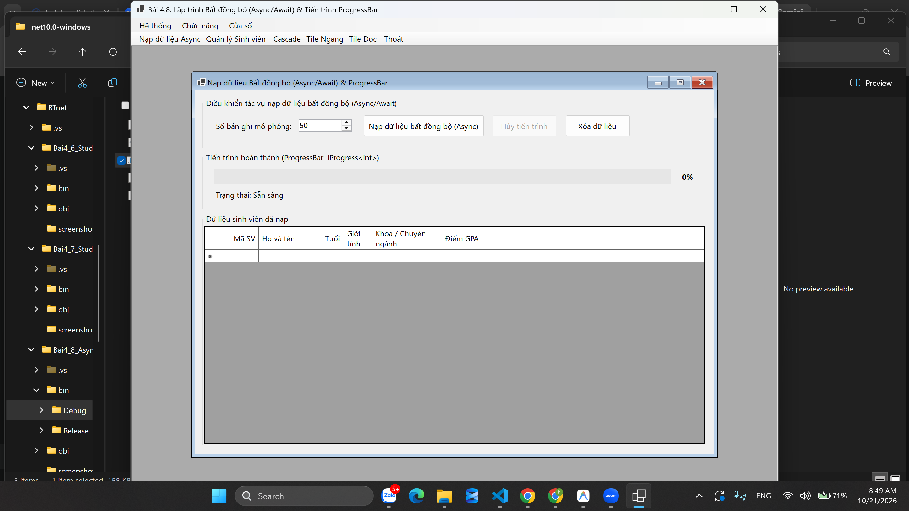
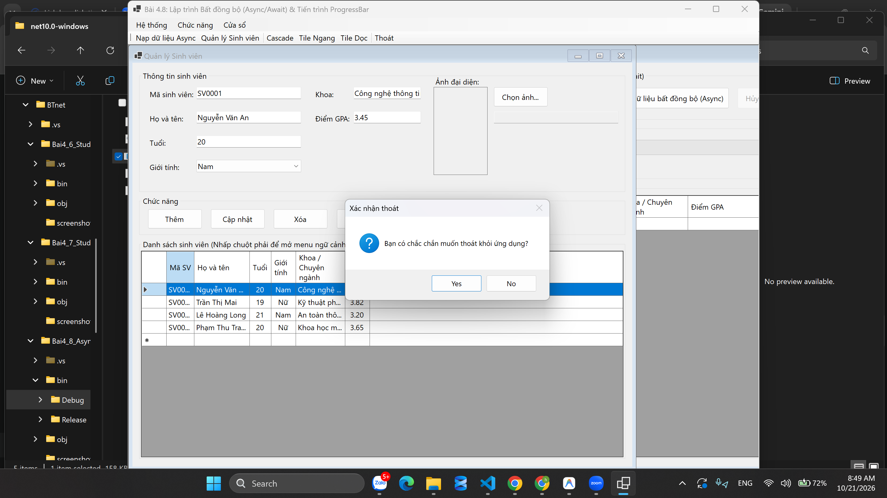
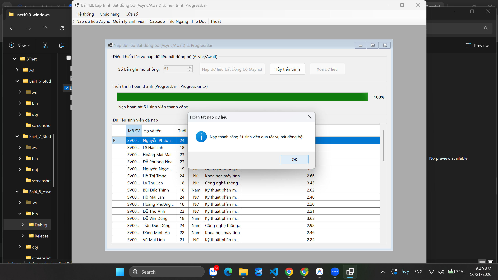
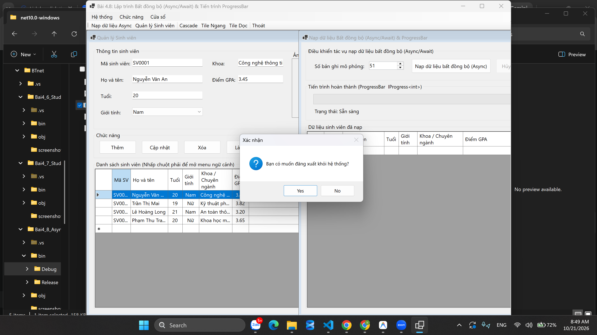

# BÁO CÁO BÀI TẬP / ĐỒ ÁN

## THÔNG TIN SINH VIÊN
- **Họ và tên:** Nguyễn Minh Đức
- **Mã số sinh viên:** 24810310226
- **Lớp:** D19CNPM3
- **Tên môn học:** Lập trình C# / Windows Forms
- **Tên bài tập:** BÀI 4.8: LẬP TRÌNH BẤT ĐỒNG BỘ (ASYNC/AWAIT) & TIẾN TRÌNH
PROGRESSBAR
---

## KẾT QUẢ THỰC HÀNH

### 1. Ảnh màn hình Giao diện chính

### 2. Ảnh màn hình Chức năng thực thi / Kết quả

